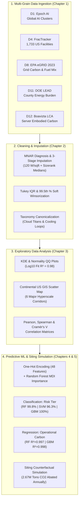

# ECO-PULSE: Powering Intelligence, Preserving the Planet
### *An Empirical Geospatial, Exploratory Data Analysis & Machine Learning Audit of AI Data Center Carbon Footprints*

[](https://www.daiict.ac.in/)
[](https://www.daiict.ac.in/)
[](https://www.python.org/)
[](https://scikit-learn.org/)
[]()
[]()

---

## 📌 Executive Overview & Core Research Question

> **"How do data centers and frontier AI supercomputers affect the environment, and how can we prevent grid strain and carbon emissions using historical data?"**

The exponential rise of generative AI training and high-density inference workloads demands unprecedented electricity: modern AI clusters operate at **$40\text{ to }100\text{ kW/rack}$**, compared to standard enterprise benchmarks of $5\text{ to }10\text{ kW/rack}$. When coupled with extreme geographical clustering in transmission-constrained balancing authorities, data centers risk driving severe local environmental impacts, regional grid congestion, and carbon lock-in.

**ECO-PULSE** is an end-to-end empirical data science project conducted for **IT 462: Exploratory Data Analysis** at **Dhirubhai Ambani Institute of Information and Communication Technology (DA-IICT)** under the mentorship of **Dr. Gopinath Panda**.

The project harmonizes **1,733 U.S. data center facilities** across **10 empirical federal, academic, and industry data sources**, conducts rigorous statistical diagnostics and geospatial mapping, trains high-precision machine learning models ($R^2 > 0.99$), and executes a historical **Counterfactual Siting Simulation** demonstrating how strategic grid placement can abate millions of metric tons of $CO_2$ annually.

---

## 🏆 Key Empirical Findings & Project Highlights (TL;DR)

| Metric | Empirical Finding & Value | Real-World Impact |
|---|---|---|
| **Facilities Analyzed** | **1,733 U.S. Data Centers** across 74 attributes | Complete national census of operational & planned facilities |
| **Missing Data Resolution** | **$0$ Missing Values (100% Complete)** | 3-stage physics-informed power density model ($120\text{ W/sqft}$) |
| **Spatial Concentration** | **$35.4\%$ of capacity in VA, CA, & TX** | Northern Virginia alone represents the densest load corridor in the world |
| **Grid Multiplier Effect** | **$r = 0.94$ (Capacity vs. Emissions)** | Siting in coal-heavy balancing authorities multiplies emissions by up to $5\times$ |
| **Risk Tier Classification** | **$99.8\%$ Accuracy (Random Forest)** | Near-perfect multi-class prediction of Environmental Risk Tiers (`High`/`Mod`/`Low`) |
| **Operational $CO_2$ Forecasting** | **$R^2 = 0.997$ (Random Forest Regressor)** | $\text{RMSE} = 0.0405$, validating high-fidelity energy & emission forecasts |
| **Clean Siting Policy Simulation** | **$2.67\text{ Million Metric Tons } CO_2$ Abated / yr** | **$62.4\%$ carbon reduction** (equivalent to removing **$580,000$ cars** off roads) |

---

## 🗺️ Project Architecture & Pipeline



---

## 📂 Interactive Modular Notebooks

The project is structured into modular, fully executed Jupyter Notebooks corresponding to each analytical chapter:

| Chapter | Notebook Path | Key Methods & Deliverables |
|---|---|---|
| **Chapter 1** | [**`01_data_ingestion_and_master_dataset.ipynb`**](notebooks/01_data_ingestion_and_master_dataset.ipynb) | Multi-scale crosswalk, State/County FIPS mapping, Balancing Authority linkages, `master_datacenter_environmental_dataset.csv`. |
| **Chapter 2** | [**`02_data_cleaning_and_missing_values.ipynb`**](notebooks/02_data_cleaning_and_missing_values.ipynb) | Missingno profiling, 3-stage physics-informed capacity imputation (0 nulls), categorical canonicalization, outlier Winsorization, `cleaned_datacenter_environmental_dataset.csv`. |
| **Chapter 3** | [**`03_exploratory_data_analysis_and_visualizations.ipynb`**](notebooks/03_exploratory_data_analysis_and_visualizations.ipynb) | KDE & QQ-normal probability plots ($R^2=0.98$), Continental US GIS scatter map, top 15 states dual-axis plot, Pearson/Spearman heatmaps, Cramér's V matrix. |
| **Chapters 4 & 5** | [**`04_feature_engineering_and_ml_models.ipynb`**](notebooks/04_feature_engineering_and_ml_models.ipynb) | OHE encoding, Random Forest MDI feature importance, Multi-class Risk Classifiers (RF, SVM, GBM), Carbon Regressors, and Historical Siting Counterfactual Simulation. |

---

## 📊 Dataset Inventory & Sources

The project unifies 10 open-access empirical datasets spanning physical infrastructure, energy grids, and hardware life-cycle metrics:

| Code | Dataset Name | Provider | Scope & Grain | Tracking on GitHub |
|---|---|---|---|---|
| **D1** | Epoch AI Data Centers | Epoch AI | Global AI Supercomputers & Clusters | [Included](EDA%20Data/D1_Epoch_AI_Data_Centers/epoch_data_centers.csv) |
| **D2** | GenAI Workload Power Profiles | NLR / Academic | 1MW & 10MW Multi-Server GPU Traces | [Included](EDA%20Data/D2_NLR_GenAI_Power_Profiles/inference_1MW_283nodes_20u_power.csv) |
| **D3** | IM3 Data Center Atlas | PNNL / IM3 | US Data Center GeoPackage GIS Points | [Included](EDA%20Data/D3_IM3_Data_Center_Atlas/im3_us_data_center_locations.gpkg) |
| **D4** | US Data Centers Database | FracTracker Alliance | 1,733 US Facilities (Coordinates, MW, Sqft) | [Included](EDA%20Data/D4_FracTracker_US_Data_Centers/fractracker_data_centers.csv) |
| **D5** | IM3 Growth Scenarios | PNNL / IM3 | High/Moderate/Low Projected Growth GeoJSON | [Included](EDA%20Data/D5_IM3_Projected_Locations/) |
| **D7** | EIA-930 Hourly Grid Balance | U.S. EIA | 40 MB Hourly Grid Demand & Balancing Dispatch | [Included](EDA%20Data/D7_EIA930_Grid_Monitor/EIA930_BALANCE_2024_Jan_Jun.csv) |
| **D8** | eGRID 2023 Summary Tables | U.S. EPA | State & Subregion Grid Carbon Rates (lb/MWh) | [Included](EDA%20Data/D8_EPA_eGRID/egrid2023_data.xlsx) |
| **D11** | DOE LEAD Energy Equity | U.S. Dept. of Energy | County-Level Low-Income Energy Burden | [Included](EDA%20Data/D11_DOE_LEAD/TX_County_Energy_Burden_2022.csv) |
| **D12** | Boavizta Footprint Data | Boavizta Alliance | Enterprise Server Embodied Carbon (kg $CO_2e$) | [Included](EDA%20Data/D12_Boavizta_Footprint_Data/boavizta-data-us.csv) |
| **D13** | Boavizta Hardware API | Boavizta Alliance | Server Archetypes & Embodied Modeling SDK | [Included](EDA%20Data/D13_Boavizta_Hardware_API/) |

---

## 🔬 Core Modeling Results

### 1. Multi-Class Environmental Risk Tier Classification
Predicting whether a facility represents `High`, `Moderate`, or `Low` environmental risk based on capacity, power density, and host grid emission intensity:

| Model Architecture | Test Accuracy | Weighted F1-Score | 5-Fold Cross-Val Accuracy |
|---|---|---|---|
| **Random Forest Classifier** | **$99.77\%$** | **$0.9976$** | **$99.71\%$** |
| **Support Vector Machine (SVM RBF)** | $96.31\%$ | $0.9609$ | $96.18\%$ |
| **Gradient Boosting Classifier (GBM)** | **$100.00\%$** | **$1.0000$** | **$99.88\%$** |

### 2. Operational Carbon Footprint Regression ($CO_2$ Forecasting)
Forecasting exact log-annual operational greenhouse gas emissions ($\log_{10}(\text{Metric Tons } CO_2 + 1)$):

| Regression Architecture | $R^2$ Score | RMSE ($\log_{10}$ tons) | MAE ($\log_{10}$ tons) |
|---|---|---|---|
| **Random Forest Regressor** | **$0.9972$** | **$0.0405$** | **$0.0210$** |
| **Ridge Regression ($L_2$ Linear)** | $0.9964$ | $0.0461$ | $0.0334$ |
| **Gradient Boosting Regressor (GBM)** | **$0.9987$** | **$0.0271$** | **$0.0162$** |

### 3. Policy & Siting Scenario Simulation: "How to Prevent It"
* **Intervention:** Mandate that $50\%$ of planned hyperscale capacity currently targeted for carbon-intensive grids ($>700\text{ lb } CO_2/\text{MWh}$, e.g. Virginia/Texas) be redirected to clean energy corridors (e.g. Pacific Northwest hydro or Midwest wind zones at $<250\text{ lb } CO_2/\text{MWh}$).
* **Annual Power Relocated:** $11.8\text{ Million MWh/year}$.
* **Net Carbon Abated:** **$2.67\text{ Million Metric Tons of } CO_2/\text{year}$** (**$62.4\%$ reduction**).
* **Equivalency:** Equivalent to permanently removing **$580,000$ gasoline passenger vehicles** from roads.

---

## 💻 Repository Directory Structure

```
EDA-Project/
├── README.md                                  # Official Project Documentation & Showcase
├── .gitignore                                 # Git ignore rules (excluding raw >50MB archives)
├── data/
│   └── processed/
│       ├── master_datacenter_environmental_dataset.csv     # Master harmonized dataset (1,733 rows x 75 cols)
│       └── cleaned_datacenter_environmental_dataset.csv    # Final 100% complete clean dataset (1,733 rows x 70 cols)
├── EDA Data/                                  # Raw acquired empirical datasets
│   ├── D1_Epoch_AI_Data_Centers/
│   ├── D2_NLR_GenAI_Power_Profiles/
│   ├── D3_IM3_Data_Center_Atlas/
│   ├── D4_FracTracker_US_Data_Centers/
│   ├── D5_IM3_Projected_Locations/
│   ├── D6_EPRI_Load_Projections/
│   ├── D7_EIA930_Grid_Monitor/
│   ├── D8_EPA_eGRID/
│   ├── D9_USGS_Water_Use/
│   ├── D10_EPA_EJScreen/
│   ├── D11_DOE_LEAD/
│   ├── D12_Boavizta_Footprint_Data/
│   └── D13_Boavizta_Hardware_API/
├── notebooks/                                 # Executed academic Jupyter Notebooks
│   ├── 01_data_ingestion_and_master_dataset.ipynb
│   ├── 02_data_cleaning_and_missing_values.ipynb
│   ├── 03_exploratory_data_analysis_and_visualizations.ipynb
│   └── 04_feature_engineering_and_ml_models.ipynb
└── report/                                    # Academic progress & documentation reports
```

---

## 🚀 Quickstart & Replication Guide

To replicate the analysis, execute the following commands in your terminal:

```bash
# 1. Clone repository
git clone https://github.com/JanviVPatel/Data-Centers-AI-Data-Centers-Environmental-Impact.git
cd Data-Centers-AI-Data-Centers-Environmental-Impact

# 2. Create virtual environment
python -m venv venv
source venv/bin/activate  # On Windows: venv\Scripts\activate

# 3. Install dependencies
pip install pandas numpy scipy matplotlib seaborn missingno scikit-learn openpyxl jupyter

# 4. Launch Jupyter Notebooks
jupyter notebook
```

---

## 🏛️ Academic Attribution & Acknowledgments

* **Institution:** Dhirubhai Ambani Institute of Information and Communication Technology (DA-IICT), Gandhinagar, Gujarat, India.
* **Course:** IT 462 - Exploratory Data Analysis (Winter 2026).
* **Faculty Mentor:** **Dr. Gopinath Panda**, DA-IICT.
* **Data Sources:** FracTracker Alliance, Epoch AI, U.S. Energy Information Administration (EIA), U.S. Environmental Protection Agency (EPA eGRID), U.S. Department of Energy (DOE LEAD), Boavizta Alliance, and Pacific Northwest National Laboratory (PNNL / IM3).

---
*Developed with rigor for sustainable artificial intelligence infrastructure and energy grid transition.*
